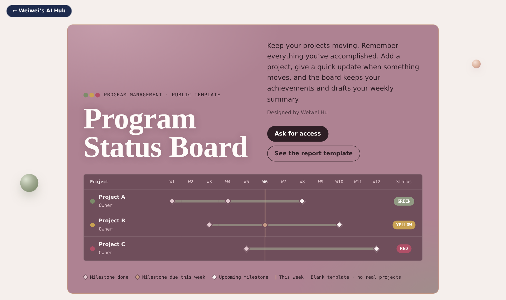
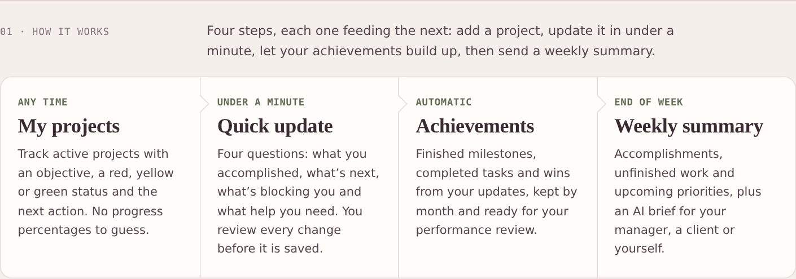

# Program Status Board

Keep your projects moving. Remember everything you've accomplished. Add a project, give a quick update when something moves, and the board keeps your achievements and drafts your weekly summary.

**See the page:** https://wei-wei-hu.github.io/program-management/

## How it works

Four steps, each one feeding the next.

1. **My projects** (any time). Track active projects with an objective, a red, yellow or green status and the next action. Describe a project in your own words and let AI set it up, or fill in a short form. No progress percentages to guess.
2. **Quick update** (under a minute). Answer four questions: what did you accomplish, what's next, what's blocking you, what help do you need. The board marks tasks done, adds what's next and records blockers. You review every change before it is saved.
3. **Achievements** (automatic). Finished milestones, completed tasks and wins from your updates, kept by month. Draft the achievements section of your performance review from your own record.
4. **Weekly summary** (end of week). Accomplishments, unfinished work and upcoming priorities, plus an AI brief for your manager, a client or yourself. Copy it as text or as a formatted table.

## Why it is different

Most project tools focus on tasks, assignments and deadlines. This one also keeps the link between your work, your progress and your own contribution, so after a few months you can answer:

- What have I accomplished across all my projects?
- Which projects have stalled, and why?
- What did I contribute this quarter?
- What are my most important unfinished commitments?

## About this repository

The board itself lives in a private, shared space for the teams I work with. This repository holds its public sample page (`index.html`), a blank template with no real project data. To see the board with your own projects, or to adapt it for your team, reach out on [LinkedIn](https://www.linkedin.com/in/weiweihu/) or by email at underlineai@gmail.com.

## License

Proprietary, viewing only. You may view this page and link to it. Copying, reuse, redistribution, imitation, scraping and AI training are not allowed without written permission. See [LICENSE](LICENSE).

---

Designed by Weiwei Hu · [Website](https://weiweihu.carrd.co/) · © 2026 Weiwei Hu. All rights reserved.
