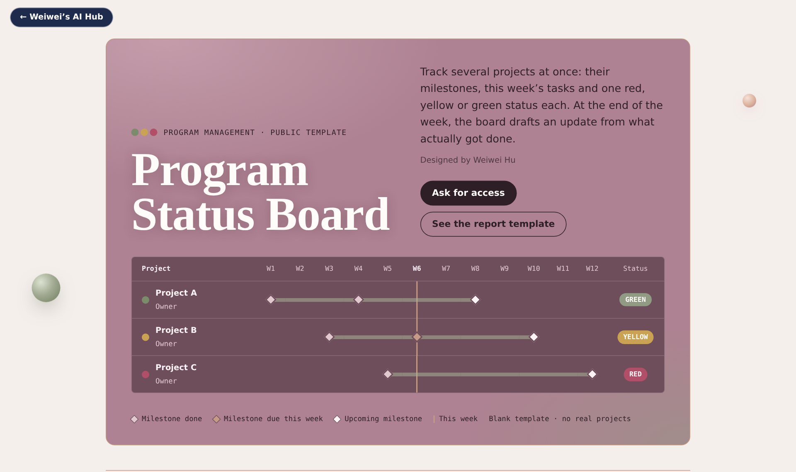
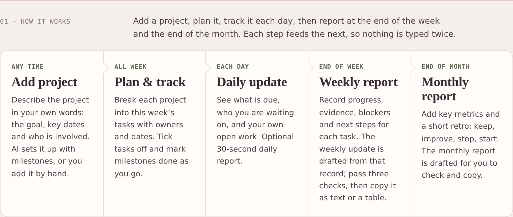

# Program Status Board

Track several projects at once: their milestones, this week's tasks and one red, yellow or green status each. At the end of the week and the end of the month, the board drafts an update from what actually got done.

**See the page:** https://wei-wei-hu.github.io/program-management/

## How it works

Five steps, each one feeding the next, so nothing is typed twice.

1. **Add project** (any time). Describe the project in your own words and let AI set up the milestones and first tasks, or fill in a short form by hand.
2. **Plan & track** (all week). Break each project into this week's tasks with owners and dates. Tick tasks off and mark milestones done as you go.
3. **Daily update** (each day). A **Start my day** checklist walks you through the routine: check what is due and what has not started, check vendor deliveries, run a short team sync (done, doing, next, then what is stuck), update your tasks, and end the day with a 10-minute report (done, risks, tomorrow) and a short review.
4. **Weekly report** (end of week). Record progress, evidence, blockers and next steps for each task. The weekly update is drafted from that record.
5. **Monthly report** (end of month). Add key metrics and a short retro: keep, improve, stop, start. The monthly report is drafted for you.

## What it handles

- **Plan by talking.** Turn dates into milestones, actions into tasks, and put the work into the right weeks.
- **Know where every project stands.** See what is done, what is happening now and what comes next. Late milestones and unfinished work stay visible.
- **Track who you are waiting on.** Record the person or vendor, what you need, the due date and when to escalate. For equipment, track shipping, arrival and installation dates.
- **Carry unfinished work forward.** Open work follows you into the current week.
- **Prepare reliable updates.** Check the numbers against the record before you send, with a live preview of the formatted report. Copy it as text, or as a table for email, Word or Google Docs.
- **Keep everyone on the same page.** Work from one shared board with the people you invite.

## About this repository

The board itself lives in a private, shared space for the teams I work with. This repository holds its public sample page (`index.html`), a blank template with no real project data. To see the board with your own projects, or to adapt it for your team, reach out on [LinkedIn](https://www.linkedin.com/in/weiweihu/) or by email at underlineai@gmail.com.

## License

Proprietary, viewing only. You may view this page and link to it. Copying, reuse, redistribution, imitation, scraping and AI training are not allowed without written permission. See [LICENSE](LICENSE).

---

Designed by Weiwei Hu · [Website](https://weiweihu.carrd.co/) · © 2026 Weiwei Hu. All rights reserved.
